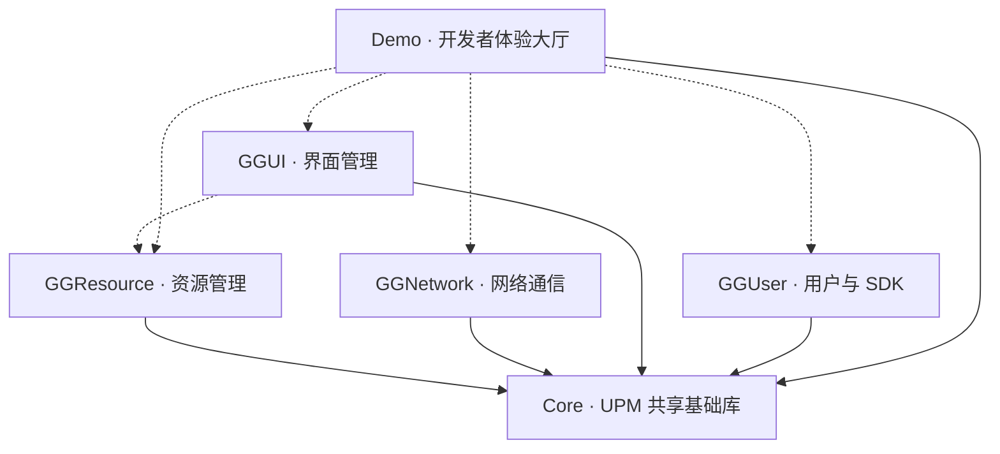

# GGFramework 架构文档（伞形仓库）

GGFramework 跨模块架构的统一维护入口，集中记录模块职责、依赖关系、架构决策（ADR）、版本矩阵和演进路线。各模块自身的 API 与接入说明保留在对应仓库。

  

## 项目导航

[Demo 体验](https://github.com/gonglei007/GGFramework-Demo) · **架构文档** · [Core](https://github.com/gonglei007/GGFramework-Core) · [GGResource](https://github.com/gonglei007/GGFramework-GGResource) · [GGNetwork](https://github.com/gonglei007/GGFramework-GGNetwork) · [GGUI](https://github.com/gonglei007/GGFramework-GGUI) · [GGUser](https://github.com/gonglei007/GGFramework-GGUser)

> **先体验整体框架**：[打开独立 Demo](https://github.com/gonglei007/GGFramework-Demo#快速开始)，体验资源、HTTP、UI、用户 SDK 与 Lua 的集成流程。[操作指南](https://github.com/gonglei007/GGFramework-Demo/blob/main/documents/showcase-guide.md) · [验收记录](https://github.com/gonglei007/GGFramework-Demo/blob/main/documents/showcase-verification.md)。

## 模块关系

各仓库独立维护。**实线表示 Core UPM 引用，虚线表示既有资源实现或集成源码副本**：

Core 是独立 UPM 包；GGResource / GGNetwork / GGUI / GGUser 尚沿用源码集成方式。GGUI 内含资源实现副本，Demo 内含模块集成副本，独立模块更新需要显式同步到消费工程。UI 与日志适配、SDK / 网关等接口由宿主注入；各模块的具体约束见其 README。

## 快速开始

- **体验功能**：单独克隆 [Demo](https://github.com/gonglei007/GGFramework-Demo)，用 Unity **6000.3.13f1** 打开 `unity_project`，运行 **GGFramework → Demo → Play Showcase**。固定 Core 依赖由 UPM 自动获取。
- **了解架构**：先读[整体技术方案](architecture/technical-solution.md)与[架构图](architecture/architecture-diagram.md)，再按下面的模块表进入 API / 快速接入文档。
- **选择模块**：按目标工程的 manifest 接入 Core 版本，再按模块说明复制源码和第三方适配；版本徽章表示当前工程声明，升级需单独验证。
- **参与维护**：本仓库维护横切方案、ADR 与路线；模块 API、工程运行方式及模块图表跟随对应模块仓库。

## 模块仓库索引

| 仓库 | 职责与集成方式 | Unity 工程版本 / 包要求 | Core 固定版本 | 入口 |
| --- | --- | --- | --- | --- |
| [GGFramework-Core](https://github.com/gonglei007/GGFramework-Core) | 共享基础设施，独立 UPM 包 | 2021.3+（包声明） | v0.3.0（稳定发布） | [API / 接入](https://github.com/gonglei007/GGFramework-Core/blob/main/README.md) |
| [GGFramework-GGResource](https://github.com/gonglei007/GGFramework-GGResource) | 资源加载 / AssetBundle，源码集成 | 6000.3.13f1 | v0.1.1 | [快速接入](https://github.com/gonglei007/GGFramework-GGResource/blob/main/documents/quickstart.md) |
| [GGFramework-GGNetwork](https://github.com/gonglei007/GGFramework-GGNetwork) | HTTP / WebSocket / HttpDNS / 下载，源码集成 | 6000.3.13f1 | v0.1.1 | [快速接入](https://github.com/gonglei007/GGFramework-GGNetwork/blob/main/documents/quickstart.md) |
| [GGFramework-GGUI](https://github.com/gonglei007/GGFramework-GGUI) | 可插拔 UI 接口，内含资源实现副本 | 6000.3.13f1 | v0.1.1 | [快速接入](https://github.com/gonglei007/GGFramework-GGUI/blob/master/documents/quickstart.md) |
| [GGFramework-GGUser](https://github.com/gonglei007/GGFramework-GGUser) | 用户 / 登录 / 支付 SDK，源码集成 | 6000.3.13f1 | v0.2.0 | [快速接入](https://github.com/gonglei007/GGFramework-GGUser/blob/main/documents/quickstart.md) |
| [GGFramework-Demo](https://github.com/gonglei007/GGFramework-Demo) | 集成源码副本与独立体验入口 | 6000.3.13f1 | v0.3.0 | [体验指南](https://github.com/gonglei007/GGFramework-Demo/blob/main/documents/showcase-guide.md) |
| [GGFramework-Docs](https://github.com/gonglei007/GGFramework-Docs) | 跨模块文档，不含 Unity 工程 | 文档采用上述工程版本 | 不直接依赖 | [技术方案](https://github.com/gonglei007/GGFramework-Docs/blob/main/architecture/technical-solution.md) |

GGUI 默认分支为 **master**，其余仓库为 **main**。版本值以各工程提交的 `Packages/manifest.json` 为准；Core 稳定发布以已存在的标签为准。

## 文档导航

- **可运行的集成体验**：[Demo 开发者体验指南](https://github.com/gonglei007/GGFramework-Demo/blob/main/documents/showcase-guide.md)。独立大厅覆盖 Core 0.3.0、本地资源与 AssetBundle、回环 HTTP、UI 页面栈、模拟 SDK 与 Lua 规则。Core 已发布固定标签 `v0.3.0`，Demo 通过公开 GitHub UPM 依赖自动获取，单独克隆 Demo 即可运行；其他模块的发布依赖保持原有声明。

- **架构**
  - [整体技术方案](architecture/technical-solution.md)：**统领性方案**——目标/原则、分层架构、各模块技术定位、集成机制、迁移路线、工程规范、测试/CI 与风险
  - [GGFramework 架构图](architecture/architecture-diagram.md)：分层架构总览、Phase 2 接线进度、Core 引用约束（mermaid 可视化）
  - [整体架构概览](architecture/overview.md)：模块职责、分层、集成方式与关键结构问题
  - [模块依赖图与版本矩阵](architecture/dependency-graph.md)：现状依赖图、目标依赖图、Unity 版本/分支/远程矩阵
  - [源码拷贝集成与副本漂移](architecture/vendoring-drift.md)：vendoring 现状、漂移清单、危害与治理
- **架构决策记录（ADR）**
  - [ADR 索引与模板](adr/README.md)
  - [ADR-0001 Core 抽为独立仓库](adr/0001-core-独立仓库.md)
  - [ADR-0002 vendoring → UPM 迁移路线](adr/0002-vendoring-转-upm-迁移路线.md)
  - [ADR-0003 Phase 3 改为副本对齐](adr/0003-phase3-改为副本对齐.md)
- **路线图 / 开发计划**
  - [贴纸游戏 Unity 移植驱动的能力扩展计划](roadmap/sticker-game-unity-porting.md)：**前瞻提案**——由《贴纸小日子》浏览器原型移植 Unity 驱动，盘点框架能力缺口，给出拟新增底层模块（`GGSave`/`GGAudio`/`GGLocalization`/`GGAds` 等）、现有模块改良清单与分阶段路线（重大取舍待另立 ADR）

## 现状速览

- 模块之间此前**没有任何工程级依赖声明**（无跨模块 UPM 引用、无跨模块 asmdef 引用），所谓"相互依赖"实际靠**源码拷贝（vendoring）**。
- 后果：68 组同名文件中 **41 组内容已漂移**；任一模块的修复不会传播到其它副本。
- 治理：抽出 `GGFramework-Core` 作为共享基础类的单一源（详见 ADR-0001 / ADR-0002）。
- **迁移进度：Phase 0/1/2/3 已全部完成。** 5 个消费方（GGResource / GGUI / GGNetwork / GGUser / Demo）均已完成 Core UPM 集成并删除本地 `Singleton`/`CoroutineUtil`/`TaskSystem` 副本，基础类副本漂移已彻底消除。Phase 2 完成时统一锁定 `v0.1.1`，后续发布版本以各工程的 manifest 为准；Demo 当前固定到 **Core `v0.3.0`**。5 个工程已统一到 Unity 6000.3.13f1，本机可真实编译/测试全部仓库。含第三方耦合的 `GameDebugger`/`ZipUtil`/`UIAdaptor`/`LogAdaptor` 因 UPM 包无法引用工程内第三方、不纳入 Core，改以**副本对齐**治理（Phase 3 已完成，详见 [ADR-0003](adr/0003-phase3-改为副本对齐.md)）：`UIAdaptor` P0 回填、`GameDebugger` 对齐 canonical（Demo 保留有意禁用），`ZipUtil`/`LogAdaptor` 已一致。整体方案见 [整体技术方案](architecture/technical-solution.md)。
