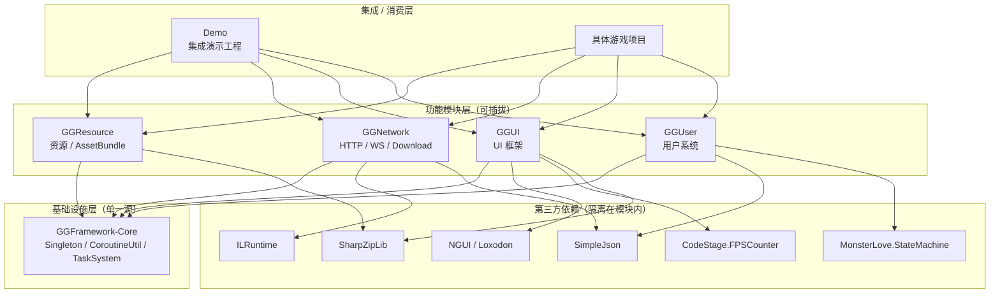
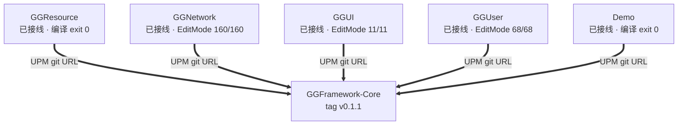
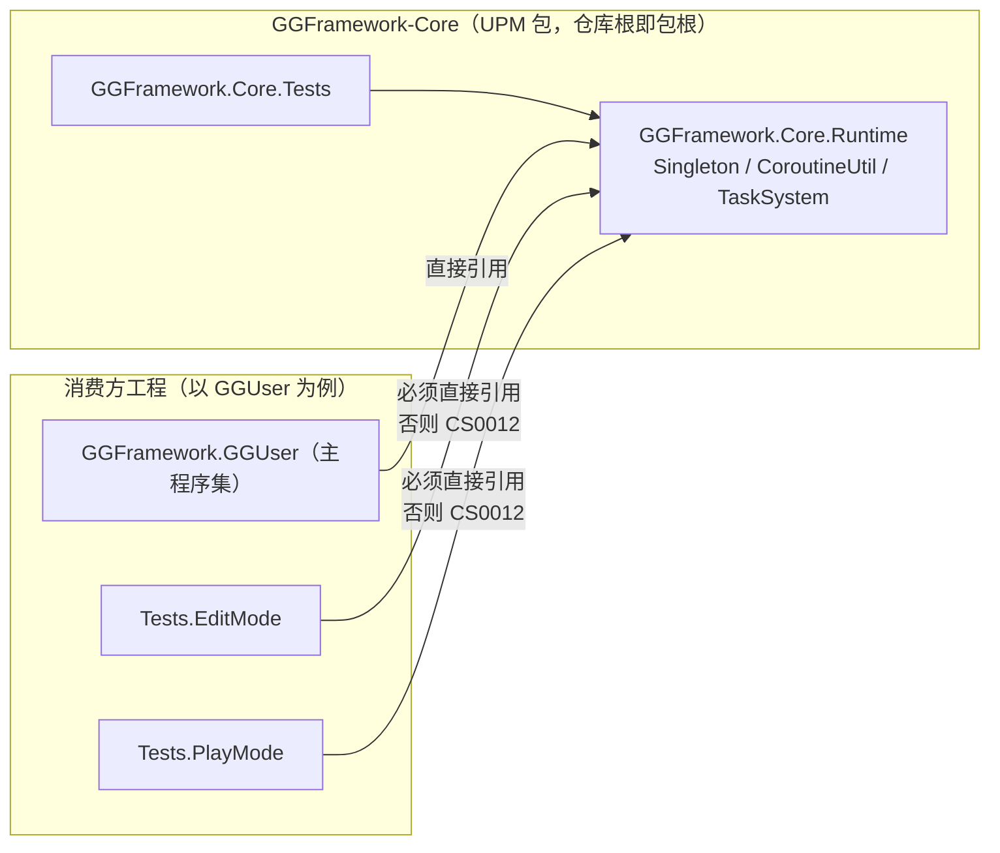

# GGFramework 架构图

> 本文用可视化图呈现 GGFramework 的**分层架构**、**Phase 2 接线进度（已完成）**与 **Core 单一源引用约束**。
> 现状 / 目标的**逐仓库依赖图**与版本矩阵见 [模块依赖图与版本矩阵](dependency-graph.md)；文字方案见 [整体技术方案](technical-solution.md)。

---

## 1. 分层架构总览（目标态）

依赖方向自上而下：**集成层 → 功能模块层 → 基础设施层**；第三方依赖被隔离在功能模块内部，不上抬到 Core。同层模块之间不直接依赖。

> 说明：`GGResource --> Core` 等五条边**均已实现**（Phase 2 完成，经 UPM git URL 引用单一源 `#v0.1.1` 并删除本地副本），见 §2 与 [vendoring-drift](vendoring-drift.md)。

---

## 2. Phase 2 接线进度（已完成）

粗实线 = 已接线（UPM git URL 引用 Core `#v0.1.1` 并删除本地副本）。**5 个消费方全部接线完成**，基础类副本漂移已消除。

> 验证前提（已满足）：5 个工程已统一到 Unity 6000.3.13f1，本机已对全部仓库真实编译/测试验证后推送。详见 [整体技术方案](technical-solution.md) §6.1。

---

## 3. Core 单一源引用约束（CS0012 防线）

`Singleton<>` 派生类型的程序集**必须直接引用** `GGFramework.Core.Runtime`——asmdef 引用**不具传递性**，主程序集引用了 Core，测试程序集仍需各自引用，否则编译报 **CS0012**。GGUser 试点中两个测试 asmdef 漏加引用即触发此错。

**另一条约束（类型二义性）**：`Singleton`/`CoroutineUtil` 在全局命名空间，"引用 Core"与"删除本地同名副本"必须**同批原子完成**，否则两份同名类型并存导致二义性编译错误。

---

## 4. 图例约定

| 记号 | 含义 |
|---|---|
| 实线箭头 `-->` | 工程级依赖 / 引用（目标态或已实现） |
| 粗实线箭头 `==>` | 已接线的 UPM git URL 引用 |
| 虚线箭头 `-.->` | 待接线 / 现状源码拷贝（无声明、会漂移） |
| `subgraph` 分层 | 集成层 / 功能模块层 / 基础设施层 / 第三方依赖 |

> 现状与目标的**逐仓库拷贝关系图**（哪份源码被拷进哪个仓库）见 [dependency-graph.md](dependency-graph.md) §1–§2，此处不重复。
