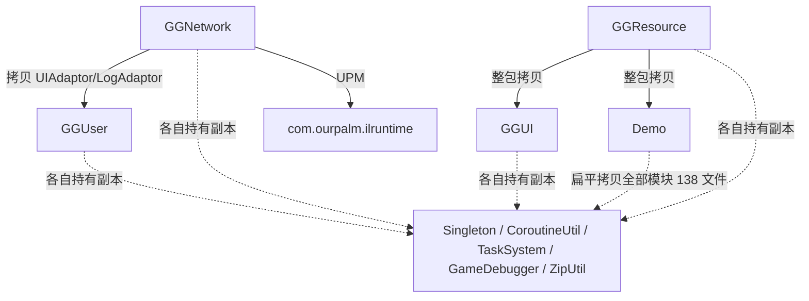
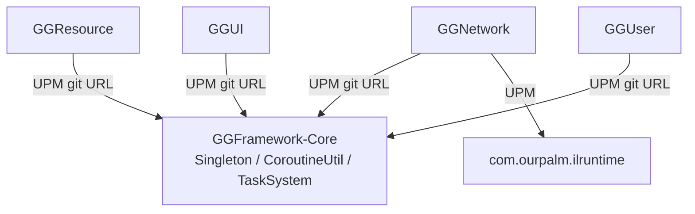

# 模块依赖图与版本矩阵

## 1. 现状依赖图（源码拷贝 / vendoring）

实线 = 工程级依赖声明（几乎没有）；虚线 = 人工源码拷贝，无声明、无版本锁定、会漂移。



要点：**没有任何模块声明对另一个模块的依赖**；所谓依赖全靠拷贝，因此修复/重构不会传播。

## 2. 目标依赖图（UPM git URL 单一源）

Core 作为共享基础类的单一源，各消费方经 UPM git URL 引用并删除本地副本。



引用写法（仓库根即包根，无需 `?path=`；建议锁定 tag）：

```json
"com.gonglei.ggframework.core": "https://github.com/gonglei007/GGFramework-Core.git#v0.1.0"
```

> **接线约束**：`Singleton`/`CoroutineUtil` 位于全局命名空间。消费方一旦引用 Core，又保留本地 `Assembly-CSharp` 同名副本，会触发**类型二义性编译错误**。因此"引用 Core"必须与"删除本地副本"**同批**完成。详见 [ADR-0002](../adr/0002-vendoring-转-upm-迁移路线.md)。

## 3. Unity 版本矩阵

| 仓库 | Unity 版本 | 默认分支 | 远程 |
|---|---|---|---|
| GGFramework-Core | 2021.3+（包声明 `unity: 2021.3`） | main | `git@github.com:gonglei007/GGFramework-Core.git` |
| GGFramework-GGResource | 2021.3.4f1c1 | main | `git@github.com:gonglei007/GGFramework-GGResource.git` |
| GGFramework-GGNetwork | 2021.3.4f1c1 | main | `git@github.com:gonglei007/GGFramework-GGNetwork.git` |
| GGFramework-GGUI | 2021.3.4f1c1 | **master** | `git@github.com:gonglei007/GGFramework-GGUI.git` |
| GGFramework-GGUser | 6000.3.13f1 | main | `git@github.com:gonglei007/GGFramework-GGUser.git` |
| GGFramework-Demo | 2019.4.18f1c1 | main | `git@github.com:gonglei007/GGFramework-Demo.git` |

**版本三分裂**：2019.4（Demo）/ 2021.3（GGResource、GGNetwork、GGUI）/ 6000.3（GGUser）。后果：

- 无法用单一编辑器打开全部工程；本机若只装某一版本，只能真实运行匹配版本的仓库测试。
- UPM git URL 的 `#branch` 后缀需逐仓库适配（GGUI 是 `master`，其余 `main`）。
- Core 的 `package.json` 将 `unity` 下限设为 `2021.3`，覆盖三个库模块；GGUser(6000.3) 向上兼容；Demo(2019.4) 若将来要接 Core 需评估兼容性。

## 4. 测试与 CI 现状

| 仓库 | 测试现状 | CI |
|---|---|---|
| Core | 10 个 EditMode 用例（结构 / Singleton 退出期 / GTask 线程），已在 Unity 6000.3.13f1 验证全绿 | 无 |
| GGNetwork | 约 16 个测试类 | 无 |
| GGUser | 9 EditMode + 2 PlayMode（EditMode 68/68 通过） | 无 |
| GGResource | 此前零测试 | 无 |
| GGUI | 此前零测试 | 无 |
| Demo | 仅 1 个手动脚本 | 无 |

> Core 包内 `Tests/` 属 UPM 包测试，消费工程须在 `manifest.json` 的 `testables` 中声明本包才会编译/运行。
