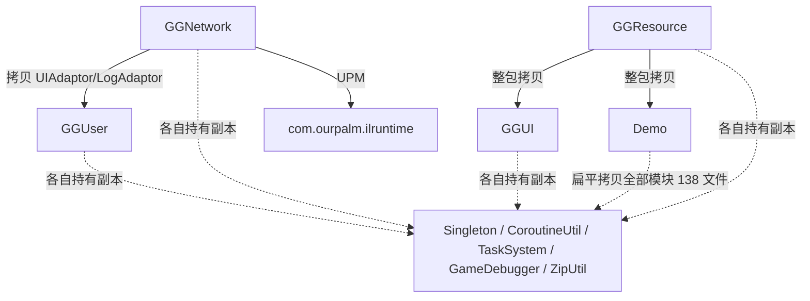
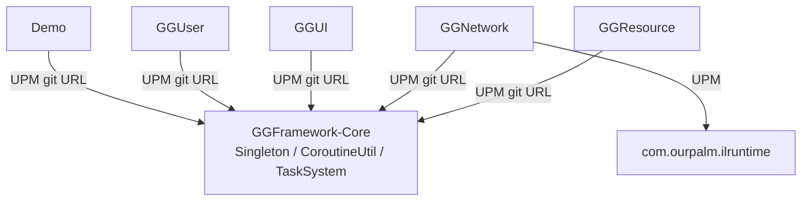

# 模块依赖图与版本矩阵

## 1. 接线前现状（源码拷贝 / vendoring，历史快照）

实线 = 工程级依赖声明（几乎没有）；虚线 = 人工源码拷贝，无声明、无版本锁定、会漂移。下图为 **Phase 2 接线前**的历史状态，基础三类（`Singleton`/`CoroutineUtil`/`TaskSystem`）当时仍靠各仓副本；现已收敛到 Core（见 §2）。



要点：**接线前没有任何模块声明对另一个模块的依赖**；基础类所谓依赖全靠拷贝，因此修复/重构不会传播。

## 2. 当前依赖图（Phase 2 已完成：UPM git URL 单一源）

Core 作为共享基础类的单一源，**5 个消费方均已**经 UPM git URL 引用并删除本地副本。



引用写法（仓库根即包根，无需 `?path=`；已锁定 tag）：

```json
"com.gonglei.ggframework.core": "https://github.com/gonglei007/GGFramework-Core.git#v0.1.1"
```

> **接线约束**：`Singleton`/`CoroutineUtil` 位于全局命名空间。消费方一旦引用 Core，又保留本地 `Assembly-CSharp` 同名副本，会触发**类型二义性编译错误**。因此"引用 Core"必须与"删除本地副本"**同批**完成。详见 [ADR-0002](../adr/0002-vendoring-转-upm-迁移路线.md)。

## 3. Unity 版本矩阵

| 仓库 | Unity 版本 | 默认分支 | 远程 |
|---|---|---|---|
| GGFramework-Core | 2021.3+（包声明 `unity: 2021.3`） | main | `git@github.com:gonglei007/GGFramework-Core.git` |
| GGFramework-GGResource | 6000.3.13f1 | main | `git@github.com:gonglei007/GGFramework-GGResource.git` |
| GGFramework-GGNetwork | 6000.3.13f1 | main | `git@github.com:gonglei007/GGFramework-GGNetwork.git` |
| GGFramework-GGUI | 6000.3.13f1 | **master** | `git@github.com:gonglei007/GGFramework-GGUI.git` |
| GGFramework-GGUser | 6000.3.13f1 | main | `git@github.com:gonglei007/GGFramework-GGUser.git` |
| GGFramework-Demo | 6000.3.13f1 | main | `git@github.com:gonglei007/GGFramework-Demo.git` |

**版本已统一**：5 个 Unity 工程（GGResource / GGNetwork / GGUI / GGUser / Demo）现均为 **6000.3.13f1**，此前的"2019.4 / 2021.3 / 6000.3 三分裂"已消除。收益：

- 可用单一编辑器打开并真实编译/测试全部工程；本机（6000.3.13f1）即可验证所有接线。
- Core 包声明 `unity: 2021.3` 下限，6000.3 向上兼容，全部消费方均可解析。
- UPM git URL 的 `#branch` 后缀仍需逐仓库适配（GGUI 是 `master`，其余 `main`），但接线统一锁定 tag `#v0.1.1`，与分支无关。

## 4. 测试与 CI 现状

| 仓库 | 测试现状 | CI |
|---|---|---|
| Core | 10 个 EditMode 用例（结构 / Singleton 退出期 / GTask 线程），Unity 6000.3.13f1 验证全绿 | 无 |
| GGNetwork | EditMode 160/160 全绿（接线后含全部 TestHTTPDNS） | 无 |
| GGUser | 9 EditMode + 2 PlayMode（EditMode 68/68 通过） | 无 |
| GGUI | EditMode 11/11 全绿 | 无 |
| GGResource | 无自动化测试；接线以 batchmode 编译 exit 0 为门槛 | 无 |
| Demo | 无自动化测试；接线以 batchmode 编译 exit 0 为门槛 | 无 |

> Core 包内 `Tests/` 属 UPM 包测试，消费工程须在 `manifest.json` 的 `testables` 中声明本包才会编译/运行。
